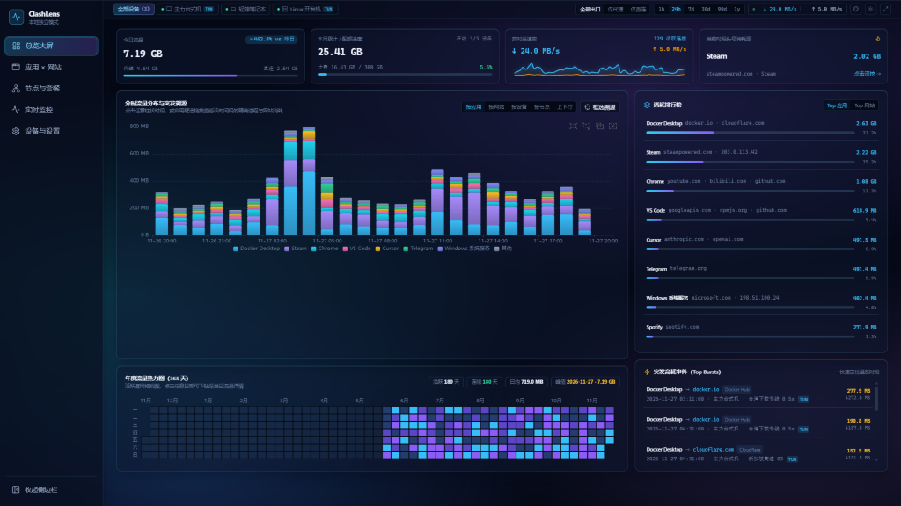
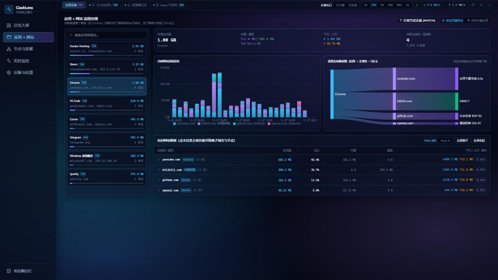
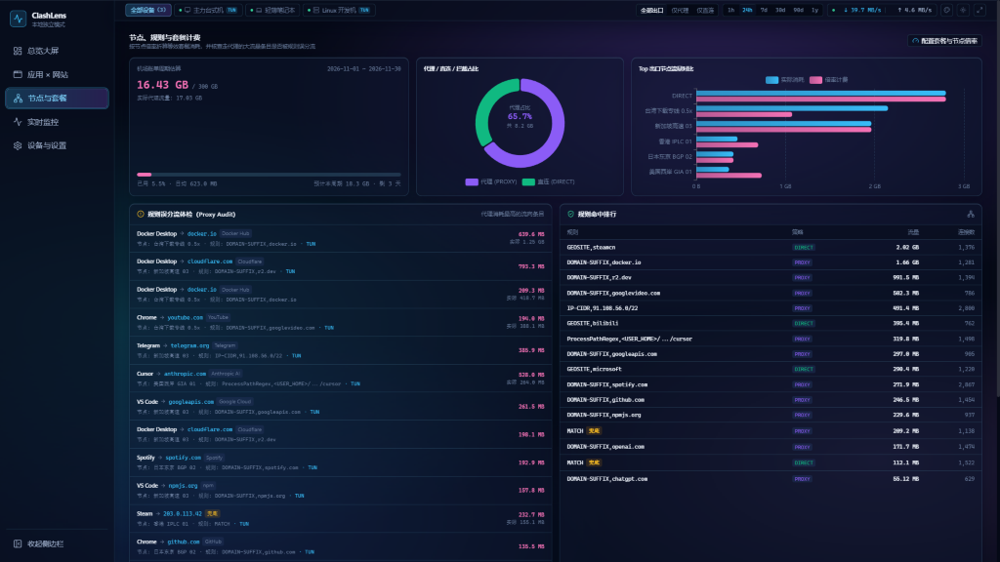
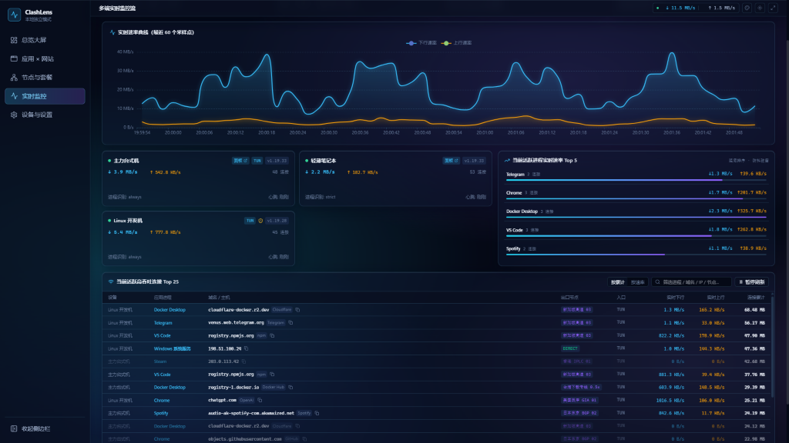
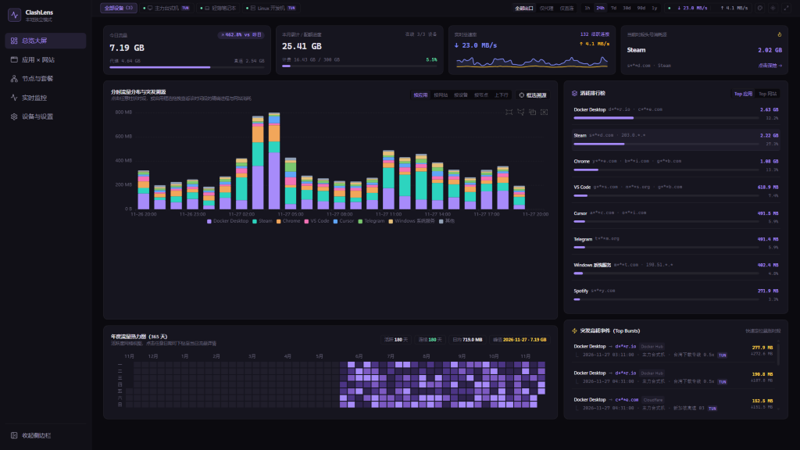
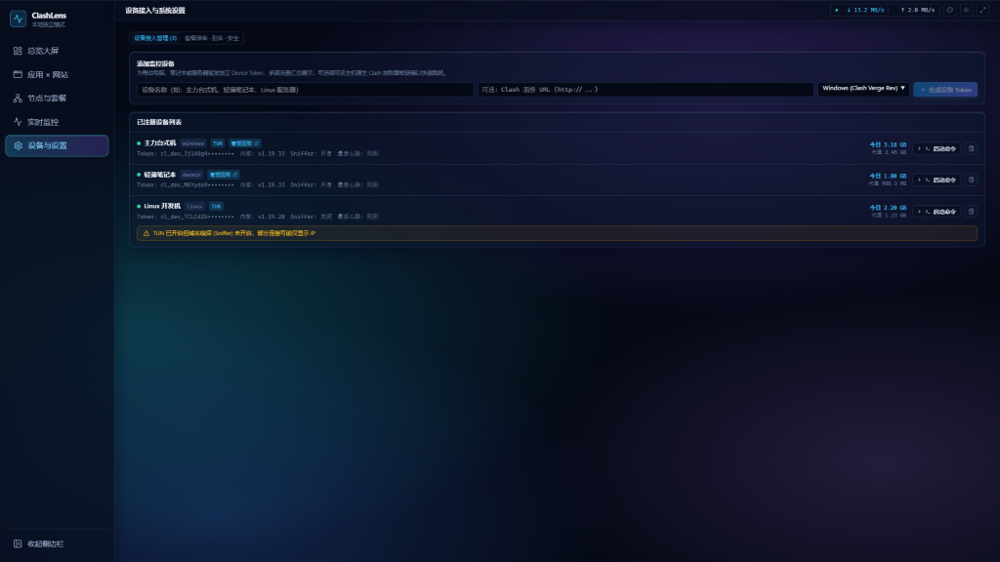

# ClashLens — Multi-Device Clash / Mihomo Traffic Telemetry Dashboard

[简体中文](README.md) | **English**

A multi-device traffic telemetry, domain attribution, and billing quota analytics platform built for **Clash / Mihomo (Clash Verge Rev and compatible cores)**. Run it either in **Cloud Hub + Multi-Device Agent mode** (desktop + laptop + Linux router/server) or in **Standalone Local Mode** (single zero-config binary).

---

## 1. Key Features

- **Overview Dashboard & 365-Day Activity Heatmap**: Tracks today's traffic vs. previous day, Proxy/Direct split, monthly usage & quota burn rate, real-time throughput sparkline, and top bandwidth consumers. Click any heatmap cell or brush-select bar chart intervals to inspect exact process/domain spikes across 5 dimensions (`App`, `Domain`, `Device`, `Node`, `Down/Up`).
- **Apps × Domains Cross-Attribution & Sankey Diagram**: Pinpoint which root domains, subdomains, egress nodes, and TUN routes any process actually talks to. Filter by `MATCH` fallback traffic, click Sankey nodes to cross-filter tables, and copy ready-to-paste Clash `YAML` or `Clash Verge JS` split rules (`IP-CIDR`, `IP-CIDR6`, `DOMAIN`).
- **Node Multiplier Billing & Proxy Rule Audit**: Configure node billing multipliers (e.g., `*IPLC* 1.5x`, `*GIA* 2.0x`, `*Download* 0.5x`) and billing reset day to compare **actual vs. billed consumption** and end-of-cycle projections. Highlights high-volume proxied flows and `MATCH` fallback rules.
- **Anti-Jitter Real-Time Monitor**: Streams 2-second WebSocket speed curves and active connections featuring **hover-to-lock ordering, 8s TTL sticky rows, EMA speed damping, concurrent host aggregation**, fixed-height scrollable containers, instant search, and independent table freeze controls.
- **Themes, Responsive Layouts & Bilingual UI (`zh` / `en`)**: Includes three curated themes — **Classic Emerald**, **Obsidian Plum**, and **Aurora Mesh** — across dark/light modes and **Classic / Bento** layouts. Switch seamlessly between **简体中文** and **English** from the top bar without unmounting charts or re-fetching analytics endpoints.
- **Lossless Tiered Cold/Warm/Hot Storage Archival**: Automatically or manually rolls up high-volume minute details (`minute_retention_days`, default `7d`) and hourly flows (`hourly_retention_days`, default `30d`) into a compact 6-dimension daily summary table (`traffic_daily_flows`), folding long-tail hosts below 100 KB into `*` while keeping 365-day heatmaps and app/domain/node analytics seamlessly queryable.
- **Community-Editable Bilingual Service Catalog**: Built-in process aliases and well-known service domain tags live in [`pkg/catalog/services.json`](pkg/catalog/services.json) using `{ "zh": "...", "en": "..." }` entries. Anyone can add missing domains or clients via a single-file Pull Request, and historical query results pick up new built-in tags automatically (while user-defined custom aliases always take precedence).
- **Privacy Masking & Health Diagnostics**: One-click global **Privacy Mask Mode** obscures hostnames, IPs, Sankey nodes, and rule payloads in charts/tables for safe screenshots/demos (copying real rules still works). Automatically warns on setups like `TUN enabled without Sniffer` and supports `.json.gz` idempotent cross-machine backup migration.

---

## 2. Screenshots

### 1. Overview Dashboard (Aurora Mesh · Bento Grid)


### 2. Apps × Domains Cross-Explorer & Flow Sankey


### 3. Node Multiplier Billing & Proxy Rule Audit


### 4. Multi-Device Live Monitor (Hover Lock & Damped Sort)


### 5. Obsidian Plum Theme & Privacy Masking Mode


### 6. Multi-Device Onboarding & Storage / Diagnostics


---

## 3. Quick Start: Two Deployment Modes

> Agents automatically discover local **Clash Verge Rev** / Mihomo instances via **Named Pipe / Unix Socket / HTTP** without requiring an open external controller port in most setups.

### Option A: Standalone Local Mode (Single Binary, Zero Server)
Best when monitoring a single workstation locally:
1. Download **`clashlens-local-windows-amd64.exe`** from GitHub **Releases** (`https://github.com/maytoku-alon/clash-lens/releases`).
2. Double-click to run — embeds the dashboard on `127.0.0.1:18080`, binds the local device automatically (**no tokens or login required**), and persists data to a local `clashlens-local.db`.
3. Use the system tray menu to **Open Dashboard** or toggle **Launch on Startup**, or start via CLI with `clashlens-agent --local`.
4. **Migration & Merging**: Under **Devices & Settings**, export a `.json.gz` archive anytime and import it idempotently on another machine or central server without double-counting.

### Option B: Central Server + Multi-Device Sync
1. **Start Server**: Deploy via Docker Compose ([deploy/docker-compose.yml](deploy/docker-compose.yml) & [deploy/.env.example](deploy/.env.example)) or run the static `clashlens-server-linux-amd64` binary.
2. **Mint Device Token**: Open **Devices & Settings** → **Add Telemetry Device**, then download `agent.yaml` to `%APPDATA%\ClashLens\agent.yaml`.
3. **Run Agent**:
   - GUI Tray binary: Download and run **`clashlens-agent-windows-amd64.exe`**, then enable autostart from the tray icon.
   - PowerShell installer:
     ```powershell
     .\deploy\install-windows.ps1 `
       -Server "http://<your-server-ip-or-domain>:8080" `
       -Token "<your-device-token>" `
       -BinaryPath "C:\path\to\clashlens-agent-windows-amd64.exe"
     ```

---

## 4. Privacy & Local Path Sanitization

When Mihomo matches `ProcessPath` / `ProcessPathRegex` rules, agents sanitize local filesystem paths by default ([deploy/agent.example.yaml](deploy/agent.example.yaml)):
- Full executable `process_path` strings are omitted from uploads by default.
- **`sanitize_mode: "mask"` (recommended default)**: Turns `ProcessPathRegex,(?i)^C:\\Users\\Administrator\\AppData\\Local\\Programs\\antigravity\\` into **`ProcessPathRegex,<USER_HOME>/.../antigravity`**, keeping app troubleshooting context while stripping usernames and directory trees.
- **`sanitize_mode: "strict"`**: Redacts path payloads completely as `<REDACTED>`.
- Server-side ingestion and startup cleanup also enforce sanitization fallbacks.

---

## 5. Linux Agent Setup

1. Download `clashlens-agent-linux-amd64` from **Releases** (or build: `CGO_ENABLED=0 GOOS=linux GOARCH=amd64 go build -o clashlens-agent ./agent/cmd/agent`), place at `/usr/local/bin/clashlens-agent`, and `chmod +x`.
2. Write `/etc/clashlens/agent.yaml` based on [deploy/agent.example.yaml](deploy/agent.example.yaml).
3. Enable the systemd unit from [deploy/clashlens-agent.service](deploy/clashlens-agent.service): `systemctl enable --now clashlens-agent`.

---

## 6. Security Recommendations

- Always terminate **HTTPS (TLS)** with Nginx or Caddy in front of public ClashLens server instances.
- Never commit `.env`, `agent.yaml`, `*.db`, or secrets/tokens. Configure GitHub Actions repository secrets (`DEPLOY_HOST`, `DEPLOY_USER`, `DEPLOY_PORT`, `DEPLOY_SSH_KEY`, optional `DEPLOY_APP_PORT`, `DEPLOY_REMOTE_DIR`) before enabling automatic deployment.
- Deployment workflows trigger only on pushes to `main` or manual `workflow_dispatch`, preventing secret exposure to external pull requests.

---

## 7. CI/CD Automation (GitHub Actions)

Defined in [.github/workflows/ci-deploy.yml](.github/workflows/ci-deploy.yml):
- **Push to `main`**: Runs frontend typecheck & Vite build, full Go test suite, static `CGO_ENABLED=0` builds, compressed SSH deploy with `watchbin` hot reload, and `/api/v1/health` verification with automatic rollback on failure.
- **Tag `v*` (e.g., `git tag v0.2.0 && git push origin v0.2.0`)**: Builds all 6 cross-platform Windows and Linux binaries and publishes a **GitHub Release**.

---

## 8. Building from Source

Prerequisites: Go 1.24+ (`CGO_ENABLED=0`), Node 22+, `pnpm`.

```bash
# 1. Build frontend assets (embedded into server/internal/webembed/dist)
pnpm --dir web install --frozen-lockfile
pnpm --dir web build

# 2. Run all tests
CGO_ENABLED=0 go test -count=1 ./...

# 3. Build binaries
CGO_ENABLED=0 go build -ldflags "-H windowsgui" -o dist/clashlens-agent-windows-amd64.exe ./agent/cmd/agent
CGO_ENABLED=0 go build -ldflags "-H windowsgui -X main.defaultLocalMode=true" -o dist/clashlens-local-windows-amd64.exe ./agent/cmd/agent
CGO_ENABLED=0 go build -o dist/clashlens-server-windows-amd64.exe ./server/cmd/server
```

---

## 9. License

[MIT License](LICENSE)
