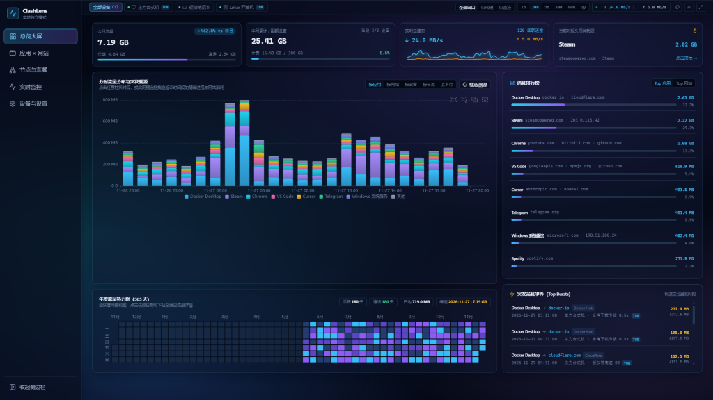
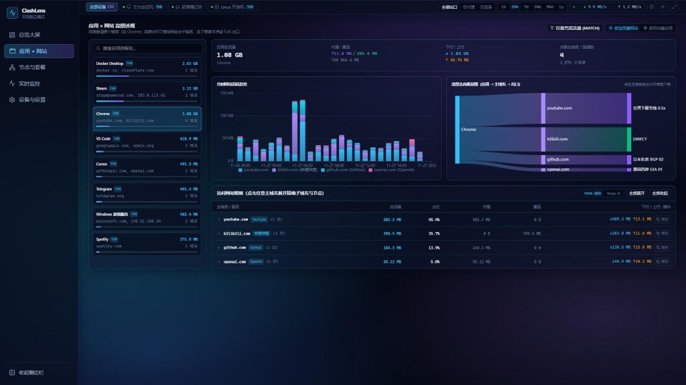
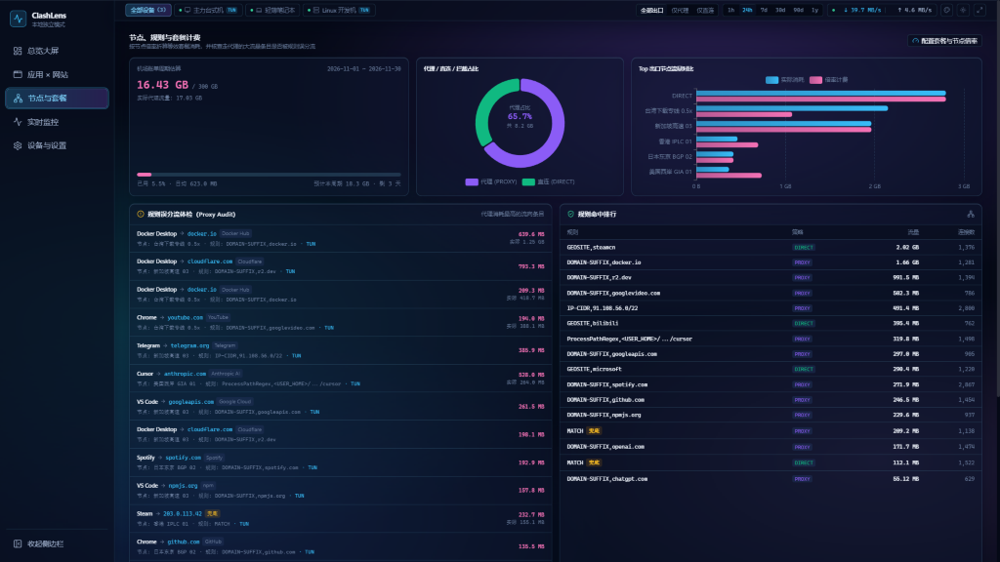
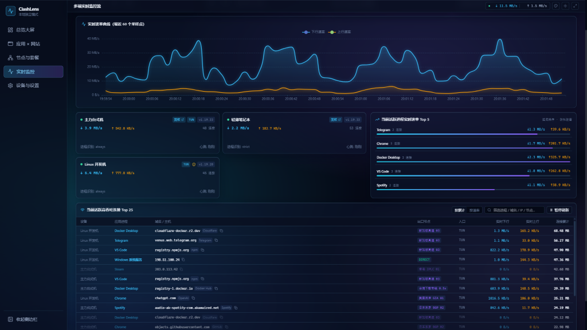
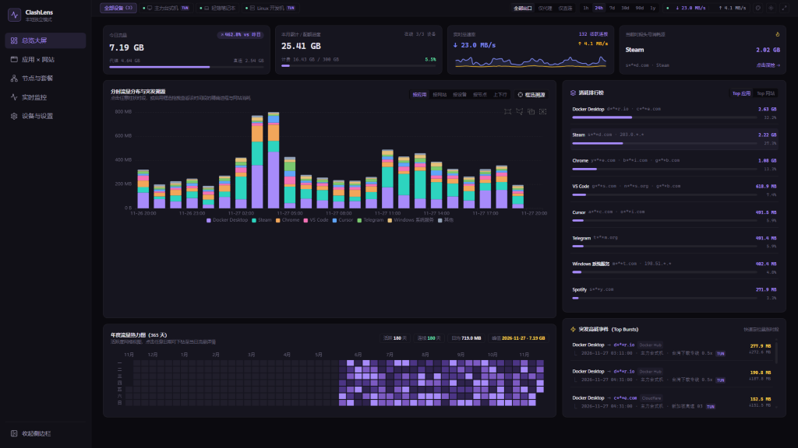
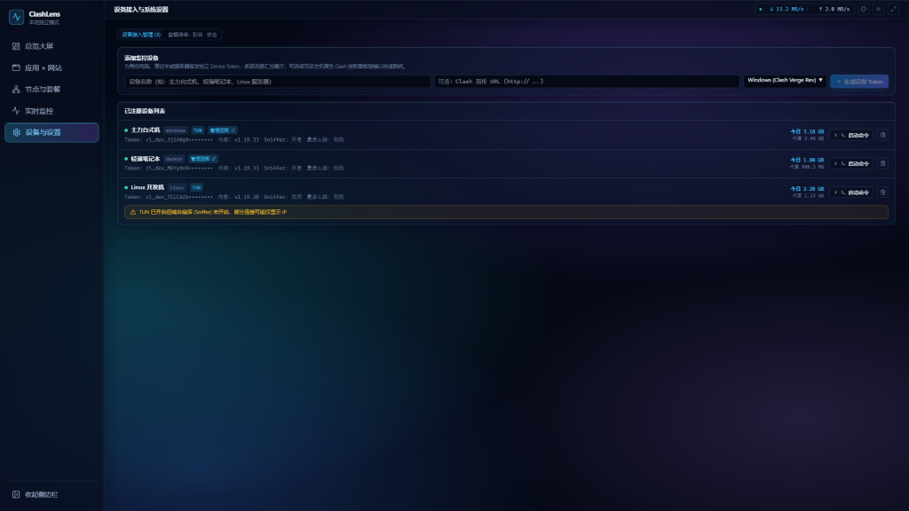

# ClashLens — 多端 Clash / Mihomo 流量透视监控大屏

面向 **Clash / Mihomo（Clash Verge Rev 等内核）** 打造的多端流量透视、归因分析与配额监控平台。既支持 **多设备云端汇聚上报**（台式机 + 笔记本 + Linux 软路由/开发机），也提供 **纯本地独立模式**（单二进制双击即用，免服务端与登录配置）。

---

## 一、核心功能介绍

- **总览大屏 & 365 天活跃热力图**：汇集今日流量与昨日同比、代理/直连占比、本月累计与配额进度、实时总速率微缩曲线、头号消耗源；支持点击任意日期下钻或框选分时柱状图突发时段（按应用 / 网站 / 设备 / 节点 / 上下行 5 维拆解）。
- **应用 × 网站 交叉深挖与桑基流向图**：精准定位某应用具体访问了哪些主域名、精确子域名及各自代理/直连节点（解决「某个进程突然跑满流量却不知在访问什么」的痛点）；支持按 `MATCH` 兜底流量筛选、点击桑基图节点联动过滤，并一键生成复制 Clash `YAML` 或 `Clash Verge JS` 规则（自动识别 `IP-CIDR` / `IP-CIDR6` / `DOMAIN`）。
- **节点倍率计费 & 规则分流体检**：配置机场节点倍率规则（如 `*IPLC* 1.5x`、`*GIA* 2.0x`、`*下载* 0.5x`）与重置日，自动换算 **实际消耗 vs 倍率计费**、周期进度及月末用量预测；内置高消耗代理明细（Proxy Audit）与规则命中排行（醒目标注 `MATCH 兜底` 流量）。
- **抗抖动多端实时监控**：每 2 秒通过 WebSocket 推送多端实时速率与活跃连接，采用 **鼠标悬停锁定排序、8 秒不活跃连接平滑驻留渐隐、EMA 速率阻尼排序、同目标并发连接自动聚合** 与定高粘性表头容器，杜绝高频刷新下的列表跳行抖动；支持搜索筛选与独立冻结连接快照（不中断后台曲线）。
- **多主题双模式 & 容器自适应排版**：内置三套手工调校主题——**经典默认**、**Obsidian Plum**、**极光暗黑（Aurora Mesh）**，均支持深/浅色模式与 **经典双栏 / Bento 宽屏** 布局无缝切换；配合 **迷你侧边栏折叠** 与 `@container` 容器查询，兼顾 2K 宽屏（最高 `2080px`）与高缩放笔记本。
- **隐私脱敏与设备健康诊断**：大屏右上角可随时一键开启 **全局隐私脱敏模式**（对域名/IP、桑基图及规则文本同步打码）；自动检测 `TUN 开启但 Sniffer 未开启` 等潜在失真配置并给出诊断提示；支持 `.json.gz` 跨机幂等备份迁移与存储空间统计清理。

---

## 二、效果展示

### 1. 总览大屏（极光暗黑 Aurora Mesh · Bento 宽屏）


### 2. 应用 × 网站 交叉深挖与桑基流向图


### 3. 节点倍率计费与规则分流体检


### 4. 多端实时监控流（悬停防抖锁定 · 阻尼排行）


### 5. Obsidian Plum 主题与全局隐私脱敏模式


### 6. 多端接入管理与环境健康诊断


---

## 三、快速上手：两种部署形态任选

> 采集端默认通过 **Named Pipe / Unix Socket / HTTP** 自动发现本机运行的 **Clash Verge Rev** 或 Mihomo 内核，通常无需额外开启外部控制端口。

### 方式 A：纯本地独立模式（无需云服务器，双击即用）
如果你只需要监控当前这一台电脑、不希望把数据传到远程主机：
1. 在 GitHub 右侧 **Releases**（`https://github.com/maytoku-alon/clash-lens/releases`）下载 **`clashlens-local-windows-amd64.exe`**。
2. 直接双击运行，它会在本机 `127.0.0.1:18080` 内嵌启动大屏并自动绑定本机设备（**零 Token 配置、免登录密码**，数据保存在本机单文件 `clashlens-local.db`）。
3. 在右下角系统托盘右键即可 **打开监控大屏** 或开启 **开机自启**；或者使用通用命令行参数启动：`clashlens-agent --local`。
4. **跨机数据迁移与合并**：在大屏「设备与设置 → 套餐倍率 · 别名 · 安全」面板可随时 **导出 `.json.gz` 备份**，在另一台电脑或云端大屏 **导入并合并备份**（采用幂等合并，绝不重复累计）。

### 方式 B：中心服务端 + 多端云同步（台式机 + 笔记本 + 软路由汇聚）
1. **启动服务端**：使用 Docker Compose（模板见 [deploy/docker-compose.yml](deploy/docker-compose.yml) 与 [deploy/.env.example](deploy/.env.example)）或直接运行静态二进制 `clashlens-server-linux-amd64`。
2. **添加设备**：打开 Web 大屏 → **设备与设置** → **添加监控设备**，生成并下载 `agent.yaml` 到 `%APPDATA%\ClashLens\agent.yaml`。
3. **运行采集端**：
   - 方式 1：下载 **`clashlens-agent-windows-amd64.exe`**（无黑框托盘版）双击运行，右键托盘勾选 **开机自启**。
   - 方式 2：使用 PowerShell 一键安装脚本并自动注册开机自启：
     ```powershell
     .\deploy\install-windows.ps1 `
       -Server "http://<你的服务器IP或域名>:8080" `
       -Token "<你的设备Token>" `
       -BinaryPath "C:\path\to\clashlens-agent-windows-amd64.exe"
     ```

---

## 四、隐私保护与本地路径脱敏

当 Mihomo 命中 `ProcessPath` / `ProcessPathRegex` 等本地路径规则时，采集端默认启用路径脱敏（配置示例见 [deploy/agent.example.yaml](deploy/agent.example.yaml)）：
- 默认不上传本地 `process_path` 可执行文件完整路径；
- **`sanitize_mode: "mask"`（默认推荐）**：将 `ProcessPathRegex,(?i)^C:\\Users\\Administrator\\AppData\\Local\\Programs\\antigravity\\` 自动脱敏为 **`ProcessPathRegex,<USER_HOME>/.../antigravity`** —— 既保留末级应用目录方便规则排障，又彻底隐藏个人用户名与本机目录树；
- **`sanitize_mode: "strict"`**：直接擦除路径参数为 `<REDACTED>`；
- 服务端在入库及启动时同样内置兜底脱敏清洗，防止旧版本采集端或历史数据留存本地路径。

---

## 五、Linux 服务器采集端接入

1. 从 GitHub **Releases** 下载 `clashlens-agent-linux-amd64`（或本地编译：`CGO_ENABLED=0 GOOS=linux GOARCH=amd64 go build -o clashlens-agent ./agent/cmd/agent`），上传至 `/usr/local/bin/clashlens-agent` 并 `chmod +x`。
2. 参考 [deploy/agent.example.yaml](deploy/agent.example.yaml) 写入 `/etc/clashlens/agent.yaml`。
3. 使用 [deploy/clashlens-agent.service](deploy/clashlens-agent.service) 启动后台守护：`systemctl enable --now clashlens-agent`。

---

## 六、公网部署安全建议

- 强烈建议在公网服务端前配置 **Nginx / Caddy 反向代理并开启 HTTPS（TLS）**，避免设备 Token 与登录凭据明文传输。
- 请勿在仓库中提交 `.env`、`agent.yaml`、`*.db` 或任何私钥/Token 文件；使用本仓库的自动部署工作流前，请在 GitHub **Settings → Secrets and variables → Actions** 中配置：`DEPLOY_HOST`、`DEPLOY_USER`、`DEPLOY_PORT`、`DEPLOY_SSH_KEY`（可选 `DEPLOY_APP_PORT`、`DEPLOY_REMOTE_DIR`）。
- CI/CD 部署任务仅针对 `main` 分支推送与手动 `workflow_dispatch` 触发，不会对外部 `pull_request` 暴露 Secrets。

---

## 七、CI/CD 自动构建与发布（GitHub Actions）

工作流定义位于 [.github/workflows/ci-deploy.yml](.github/workflows/ci-deploy.yml)：
- **推送 `main` 分支**：自动执行前端类型检查与构建（`tsc --noEmit` + `vite build`）、全量 Go 测试、`CGO_ENABLED=0` 静态编译，并通过 `zstd` 压缩与 4 路并发 SSH 流式部署至自有服务器，配合 `watchbin` 热更新与 `/api/v1/health` 失败自动回滚。
- **推送 `v*` 标签（如 `git tag v0.2.0 && git push origin v0.2.0`）**：自动交叉编译 Windows（托盘云端版 / 本地独立版 / CLI 诊断版 / 服务端）与 Linux 全部 6 个二进制并发布 **GitHub Release**。

---

## 八、本地从源码构建

前置依赖：Go 1.24+（`CGO_ENABLED=0`）、Node 22+、`pnpm`。

```bash
# 1. 构建前端大屏（输出至 server/internal/webembed/dist）
pnpm --dir web install --frozen-lockfile
pnpm --dir web build

# 2. 运行全量测试
CGO_ENABLED=0 go test -count=1 ./...

# 3. 编译各端二进制
CGO_ENABLED=0 go build -ldflags "-H windowsgui" -o dist/clashlens-agent-windows-amd64.exe ./agent/cmd/agent
CGO_ENABLED=0 go build -ldflags "-H windowsgui -X main.defaultLocalMode=true" -o dist/clashlens-local-windows-amd64.exe ./agent/cmd/agent
CGO_ENABLED=0 go build -o dist/clashlens-server-windows-amd64.exe ./server/cmd/server
```

---

## 九、开源协议

[MIT License](LICENSE)
